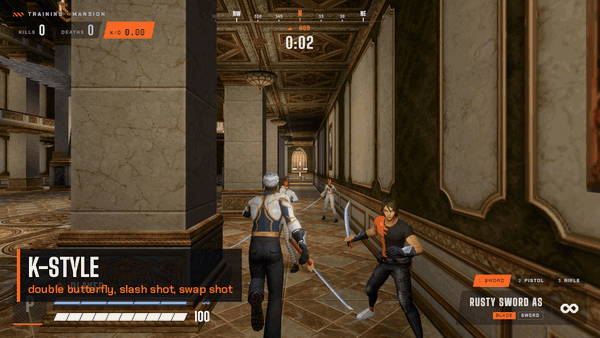
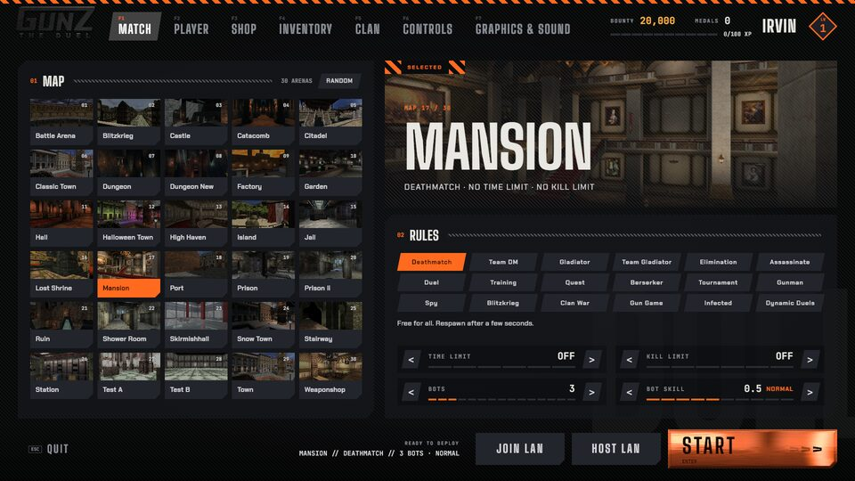
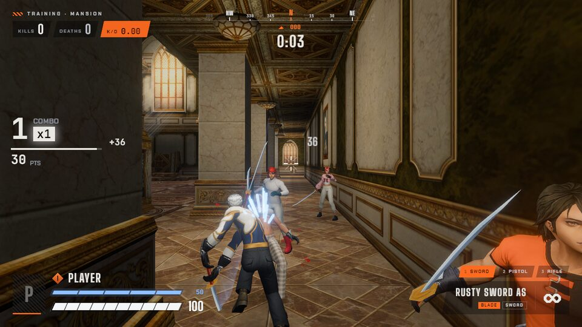
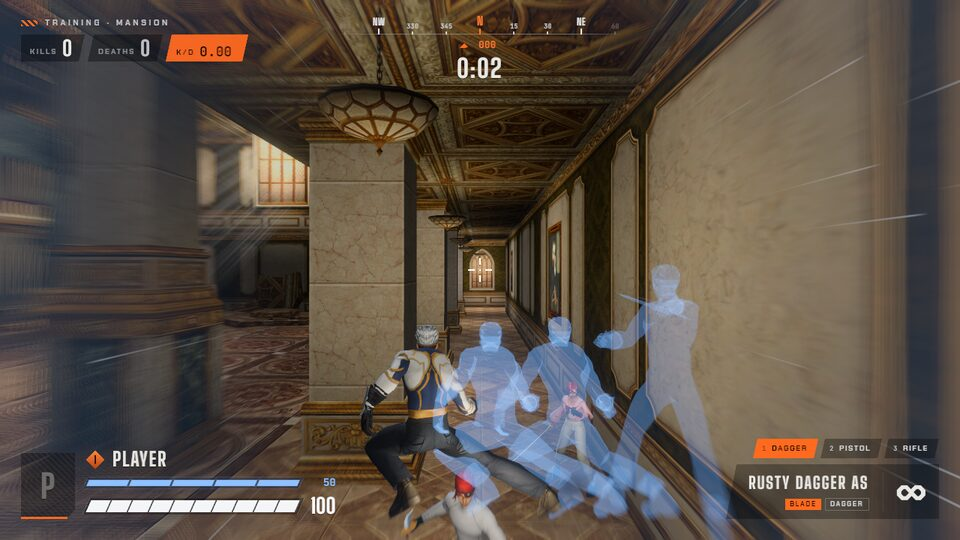
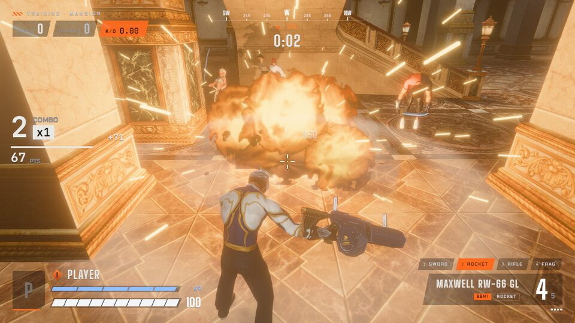
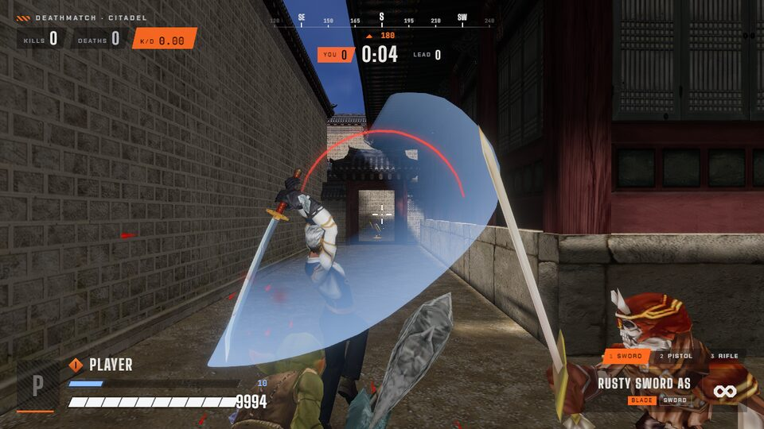
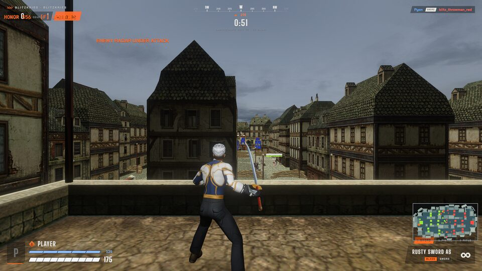

<div align="center">



# GunZRs

**GunZ: The Duel, rebuilt in Rust.** A clean-room port on [Bevy](https://bevyengine.org) that plays
the original maps, characters, weapons, monsters and sounds straight from your Steam install, with
the butterflies, wall cancels and yoyo steps that made the game.

[](https://github.com/OpenRsG/GunZRs/releases)
[](https://github.com/OpenRsG/GunZRs/actions/workflows/ci.yml)
[](LICENSE)
[](https://store.steampowered.com/app/3139440/GunZ_The_Duel/)

[Quick start](#quick-start) · [Techniques](#k-style-and-d-style-techniques) · [Game modes](#game-modes) · [Browser](#in-the-browser-webgpu) · [How it works](#how-it-works)

</div>

## Highlights

- **The real moves.** Butterfly up to the quadruple BF, slash shot, half step, forbidden step, wall
  cancel, flash climb, dagger flash, yoyo steps, E-lunge: 38 techniques from the community K-style
  and D-style guides, each one played headless and checked in the log (the handful that are left
  out are listed [under the techniques](#k-style-and-d-style-techniques)). Bots use them too, more
  often the better they are.
- **18 game modes.** The 15 retail modes with the original rules (deathmatch is everyone against
  everyone, the berserker is whoever kills first) plus Infected, Gun Game and Dynamic Duels.
- **The whole game world.** All 30 maps, quest, challenge and survival scenarios, 76 monsters with
  their own AI, Blitzkrieg with radars, waves and classes, clans and a shop with 215 items.
- **Bots that play.** Path-finding across stairs, drops and wall kicks, weapon choice by range,
  grenades, retreats, guarding and techniques scaled by skill.
- **Original look, or better.** The ORIGINAL preset draws the image exactly as the game did; ENHANCED
  and ULTRA add HDR, bloom, lit characters, full explosions and simulated blood.
- **Plays where you are.** Linux and Windows downloads, a WebGPU browser build with touch controls,
  and LAN multiplayer.

| | | |
|:-:|:-:|:-:|
|  |  |  |
| Main menu | K-style against the dummies | D-style dagger dashes |
|  |  |  |
| ULTRA explosions | Quest monsters | Blitzkrieg |

No game files are included (the demo and screenshots are captures for illustration). You need your own
copy of the game; the port only reads its `.mrs` archives and never runs `Gunz.exe`.

## Quick start

Install [GunZ: The Duel on Steam](https://store.steampowered.com/app/3139440/GunZ_The_Duel/) first
(or paste `steam://install/3139440` into your browser). GunZRs finds it through Steam's library
folders, Flatpak Steam included; `GUNZ_GAME=/path/to/GUNZ THE DUEL` points it anywhere else.

```sh
# Arch: build and install the package (the gunzrs command and a menu entry)
git clone https://github.com/OpenRsG/GunZRs && cd GunZRs/packaging/arch && makepkg -si

# Ubuntu / Debian (22.04 or newer): download gunzrs_<version>_amd64.deb from the latest release, then
sudo apt install ./gunzrs_*_amd64.deb

# Any x86_64 Linux: the latest release into ~/.local, no root
curl -fsSL https://raw.githubusercontent.com/OpenRsG/GunZRs/main/install.sh | sh
```

Then run `gunzrs` (or GunZRs from the application menu). On Windows, unzip
`gunzrs-<version>-windows-x86_64.zip` from the [latest release](https://github.com/OpenRsG/GunZRs/releases/latest)
and double-click `start.bat`.

You should see the main menu with a picture on every map tile. The retail data has no map pictures,
so the first start renders them from your install (under a minute, 960x540 PNGs in `previews/`
beside your profile file); after that the game opens at once. The menu, the loading screen and the
match share one window: START, MAIN MENU and PLAY AGAIN never reopen it.

<details>
<summary>Build from source</summary>

Install [Rust](https://rustup.rs) and the system libraries:

```sh
sudo pacman -S --needed base-devel alsa-lib systemd-libs                    # Arch
sudo apt install build-essential pkg-config libasound2-dev libudev-dev \
    libwayland-dev libxkbcommon-dev libx11-dev                               # Ubuntu / Debian
```

On Windows, rustup and the Visual Studio C++ build tools are enough. Then:

```sh
git clone https://github.com/OpenRsG/GunZRs && cd GunZRs
./start.sh                                     # builds, renders the map pictures once, opens the menu
cargo run --release --bin gunz-play -- "/path/to/GUNZ THE DUEL" Mansion --bots 3   # straight into a match
```

Releases come from `.github/workflows/release.yml` when a `v*` tag is pushed: a portable Linux
tarball (built on Ubuntu 22.04, so glibc 2.35 or newer), the `.deb` and the Windows zip.

</details>

| Steam install | Game folder |
|---|---|
| Linux (native) | `~/.steam/steam/steamapps/common/GUNZ THE DUEL` |
| Linux (Flatpak) | `~/.var/app/com.valvesoftware.Steam/.local/share/Steam/steamapps/common/GUNZ THE DUEL` |
| Windows | `C:\Program Files (x86)\Steam\steamapps\common\GUNZ THE DUEL` |

The port is developed and played on Linux. CI builds and tests Linux, Windows and macOS, but nobody
has played it on Windows or macOS yet.

## Controls

Defaults follow the original game's `config.xml`; C, T, F5-F9, `[` and `]` are this port's extras.

| Key | Action |
|---|---|
| Mouse | Aim (cursor is grabbed) |
| W A S D | Run (full speed at once, stops at once); double-tap a direction to dash |
| C | Dash: a 16 m/s burst in the held direction (forward if none) |
| Space | Jump; near a wall in the air: wall kick; jumping with W held right at a wall: wall run (up it when facing it, along it at a glancing angle) |
| Left mouse, left Ctrl | Attack (hold for automatic guns, chain slashes into a combo; with a blade, hold until the charge completes for a massive: the next slash throws it) |
| Right mouse | Alternative fire: the sword's uppercut (flip), the dagger's lunge |
| Left Shift | Guard (melee); a slash you block gives you a massive charge |
| R | Reload |
| 1-5, Q / E, wheel | Switch weapon (Q and wheel up: previous; E and wheel down: next) |
| Tab | Scoreboard |
| Esc | Pause menu (resume, controls, option toggles, main menu, quit) |
| Numpad 1-6, T, F5-F9 | Taunt, emotes (bow, wave, laugh, cry, dance) |
| [ / ] | Mouse sensitivity down / up |
| F | Blitzkrieg upgrade panel (Up/Down, Enter buys) |
| M | Blitzkrieg minimap on / off |
| 1-9, arrows, Enter | Blitzkrieg class screen at the start of the match (30 s; click works too) |

CONTROLS (a main-menu tab, and in the Esc menu) rebinds every action above except Esc and the
Blitzkrieg keys, two bindings each: keys, mouse buttons 1-5 or the wheel. A key taken from another action says so. The mouse side
has sensitivity (shown as cm per 360 at 800 and 1600 DPI), vertical ratio, invert, acceleration
with its limit and a live speed curve, and, in the browser, raw input (unaccelerated pointer lock
in Chromium browsers; the desktop build always reads raw mouse motion). Everything is saved in
the profile.

GRAPHICS & SOUND (a main-menu tab, and in the Esc menu) has three presets and every setting by itself:
ORIGINAL draws the image exactly as the game always did (no tonemapping, no effects, 4x MSAA);
ENHANCED (the default) and ULTRA add HDR with tonemapping, bloom, SMAA, sharpening, anisotropic
filtering, distance fog, vignette, film grain, chromatic aberration and camera-turn motion blur;
every screen effect has its own strength (OFF costs nothing): speed effects (light rays and radial
blur while dashing or falling, and a dash that widens the view for a moment), a hit flash, and a
drained, throbbing screen at low health. Dust
rings from the game's own effects mark ground dashes, wall kicks and hard landings. LIGHTING lights the characters
from the map's own lightmap colours (with a rim light), lights up the walls, floor and characters
around muzzle flashes and explosions, and puts a soft contact shadow under every character.
WORLD EFFECTS has the Explosions slider: at 0 (ORIGINAL) rockets and grenades show the game's own
fireball sprite; above it they become a full explosion (a blinding flash, a fireball that cools
into a lingering smoke plume, bouncing sparks, debris, dust along the floor, a shock ring and a
scorch mark, a strong light and a camera shake), richer at ULTRA.
Also field of view, vsync and a frame limit (not in the browser). Changes show in the match at once
and are saved in the profile; `gunz-play --gfx original|enhanced|ultra` picks a preset for one run.

PLAYER (a main-menu tab) shows your character idling in its lobby pose. Its EFFECTS panel has two
tabs. DASH picks what a dash leaves behind (afterimages, glowing sparks, both, or nothing); SLASH
picks the trail your sword swings leave (arc, energy, fire or none, plus sparks where a blow
lands). Both choose a colour (team, cyan, gold, violet, ember, toxic or rainbow) and an amount; the
character dashes or swings a katana in the preview to show each change, and DEMO replays it.
Your colour is used for your own dashes and swings; other players keep team colours. None of the
trails are in the original game, so the ORIGINAL graphics preset hides them.

Combo meter and killing sprees (not in the original game; the `Combo` option or `--no-combo` hides
them): every hit you land within 2.5 s of the last grows a combo whose multiplier climbs from x1 to
x8 (at 5, 10, 20, 35, 50, 70 and 100 hits), and damage and kills score points times it. Kills less
than 4 s apart announce DOUBLE, TRIPLE, QUAD, MULTI and MONSTER KILL; kills without dying announce
KILLING SPREE (3), RAMPAGE (5), DOMINATING (7), UNSTOPPABLE (10) and GODLIKE (15). Each banner
slams in with a screen-edge flash, a shake and its own sound. The sounds are synthesized in code.

Dead in a round mode? Space or click cycles the player you spectate.

Your profile (level, XP, bounty, inventory, equipped items) is saved in
`$XDG_DATA_HOME/gunzrs/profile.txt` (`%APPDATA%\gunzrs\profile.txt` on Windows). Kills and match
results pay XP and bounty; spend the bounty in the SHOP tab and equip items in INVENTORY.

### K-style and D-style techniques

The original game's bug-born movement tech works as ordinary features, always on, for you and the
bots (timings are estimates, see `docs/formats.md` "K-style and D-style techniques"). With the
default loadout (katana, revolver, rifle) and the keys above, every technique of the usual K-style
guide works; with a dagger in a slot (`--loadout 2000000,2050000,2100001`, or the dagger from the
shop) so does the D-style one. Each input sequence was played headless and its log checked:

| Technique | How |
|---|---|
| Dash, air dash | C or a double tap: a 16 m/s burst with the game's dash effect; one in the air per jump; a slash out of a dash, a wall kick or a jump gives it back; after falling for 1.5 s you can dash in the air without limit (super dash) |
| Dash cancel | Slash during a dash, a wall kick or a wall run to cancel it: full control, switch, guard, jump or dash again |
| Flying / wall climbing | Wall kick, slash, jump off the wall again at any point of the slash (a jump pressed up to 0.15 s early counts); two kicks per jump, so mashing jump + attack no longer climbs a wall without end (flash climb: slash, switch to a gun and back, jump) |
| Switch cancel | Switch weapons during an air slash: slash shot (jump, slash, switch to a gun, shoot), flash step (slash, gun, back to the blade: no draw delay) |
| Reload shot, shimmer shot | Shoot, tap reload, switch weapon, shoot: the reload cancels the draw delay of the next weapon, a dagger or sword too |
| Swapshot | Shoot, switch to the other gun, shoot: each gun keeps its own fire delay |
| Gravity cancel | An air slash near the top of a jump (or falling) holds your height for a moment, once per jump; every air slash is the quick `attack_Jump` swing, rising or falling |
| Massive | Hold attack with a sword until the charge completes (a chime, the blade glints), or block a slash: you hold a massive charge for 6 s and the next slash throws it, double damage and a knock-back; on the ground with a wind-up, in the air at once, locked in the throw until you land. A guard facing it stops it |
| Wall hang | In the air against a wall, or running up or along one, hold guard (Shift) with any weapon that allows wall moves: you cling for up to 1.2 s, once per jump; forward + jump climbs up to 2 m, jump alone kicks off the wall, letting go drops |
| Butterfly | Slash, then guard before the recovery ends: the guard cancels the recovery (it roots you like any guard); jump or dash out of it |
| Air butterfly (BF, double / triple BF) | The same guard cancels an air slash in the air: jump, dash, slash, block; jump, slash, block, dash, slash, block; or jump, slash, block three times (a jump pressed just before landing is kept) |
| Block cancel (quadruple BF) | Guard during a slash lands the hit at once and goes straight to the guard; press guard with the next direction for the glitch rhythm |
| Quick launch, juggle | Uppercut (right mouse), guard to cancel its recovery; an uppercut on an airborne launched enemy keeps them up; flip, block, jump, dash, slash, block |
| Extended flip | Dash right out of the uppercut |
| Half step, reload half step, forbidden step | A shot during a dash fires and the dash goes on (it gives the air dash back); reload out of it, mix with slashes and switches |
| Wall cancel, advanced wall cancel | Dash back into a wall and kick off it again (with a switch cancel in between for the advanced one) |
| Multi wall run | Dash at a wall at about 45 degrees and jump twice: a second kick off another wall |
| Wall hang cancel | Guard against a wall ends a wall run or a kick's flight in a hang |
| Wall spring | Jump out of a wall run: a plain kick off the wall |
| Insta-kill | Uppercut, then switch to a gun right after it hits and shoot the airborne enemy |
| Light step | A dash right after a slash makes no dash sound |

D-style (dagger; it has no guard, its alternative fire on the right mouse is the lunge):

| Technique | How |
|---|---|
| Stab | Click, on the ground and in the air; it cancels dashes, wall runs and hangs like a slash does |
| Dagger train, hop, flash | Dash + stab; jump + dash + stab; then a second dash to the other side + stab in the same jump |
| Float step, gear tap, triple stab | Dash, stab, jump; dash, jump; float step then two more dash + stab |
| Wall cancel, hells climb, wall raid | Kick, stab, dash back at the wall, kick again; hang, forward + jump, stab, jump; wall run, stab, jump at once |
| Shimmer shot, jump shot dash | Gun, shot, reload, dagger, dash; the same after a jump |
| Yoyo step, yoyo half and quarter, blink step | Jump with the gun, dash at the top, shot, reload; then dagger, dash to the other side, stab, dash (a shot in a dash gives the air dash back); blink step: jump with the dagger, dash, switch to the gun, shot |
| Lunge, extended lunge | Alternative fire on the ground lunges and launches. Start it in a dash, or on the press of a direction's second tap (or Dash): the lunge slides about 5 m in the dash's direction (forward, sideways, backwards) before it strikes, with twice the reach (a target 8 m away is hit; a plain lunge reaches 2.25 m) |
| Dagger machine, dagger juggle | Stab every 0.33 s and the target stays flinched; stab a launched target to keep it up |
| Block tap | A guarded stab recoils you; look all the way up or down while stabbing and it does not |
| Phantom | A dash or a lunge halves your hitbox for its duration |

Not in: Walk Charge (needs the chat box) and macros, Ghost Evade, Magic Switch, Massive Tap.

Bots use the techniques by skill: at skill 0 none, from 0.2 the butterfly (dagger carriers: the dagger
train), up to the quadruple butterfly and forbidden step (yoyo half) from 0.85; the better the bot, the
more often it tries them. They also climb a wall with a hang to reach an enemy on a ledge. Bots react
like people: a NORMAL bot needs about 0.35 s to guard against a swing it sees coming (0.15 s at skill 1),
aims guns with a visible error and saves launches and juggles for the higher skills.

## Game modes

Bots fill the seats (`--bots N`, skill 0-1). Limits come from the retail `gametypecfg.xml`; rules the
data does not hold follow public descriptions of the original and are marked **inferred** in
`docs/formats.md`.

| Mode | Rules |
|---|---|
| Deathmatch | Free for all: everyone against everyone, bots included; respawn after 5 s |
| Team DM | Red against Blue with respawns; team kills count |
| Gladiator, Team Gladiator | The same with melee weapons only |
| Elimination | Team rounds; nobody respawns until the round is decided |
| Assassinate | Team rounds; each side has a VIP, the round ends when one dies |
| Duel | One on one; the winner stays, the loser goes to the back of the queue, the rest watch |
| Duel tournament | A knockout bracket of duels; on time-out the one who dealt more damage wins |
| Berserker | Deathmatch where the first killer becomes the berserker: a blue aura, 150 % damage, armour and then health draining (never below 1), a refill per kill; whoever kills it takes over |
| Gunman | Deathmatch with a random melee weapon and gun every life |
| Spy | Rounds: hidden spies with the spy items (`spymode.xml`) against trackers who get pings |
| Blitzkrieg | Two bases whose radars send soldier waves down the lanes; barricades, honor upgrades, nine classes, minimap, announcer and rewards |
| Clan War | Your clan against a rival clan, 4 against 4, elimination rounds, both emblems shown |
| Quest | Quest, challenge quest and survival scenarios with bot allies: sectors, waves, bosses, portals, drops |
| Training | Dummies to slash and shoot; no XP |
| Infected *(port extra)* | Rounds: one random player turns zombie (blade only, faster, tougher, knockback hits); whoever a zombie kills joins them; survivors win at the timer |
| Gun Game *(port extra)* | Free for all up a 12-step weapon ladder; a kill upgrades your weapon, a melee kill demotes the victim, a kill from the last step wins |
| Dynamic Duels *(port extra)* | Several duels at once on one map, each in its own arena phase; winners stay, losers queue and watch, Space switches the watched arena |

## Status

### Working

| Area | What you get |
|---|---|
| Maps | All 30 RS v7 maps plus quest maps, with lightmaps, skies and every prop (fires, light shafts, water, fans, waving flags and curtains) |
| Collision | Retail `.RS.col` BSP: stairs, slopes, walls, ceilings |
| Characters | Man and woman models; every clothing piece of the item data (102 chests, 50 legs, 33 hair/hats... for the man) chosen per slot with optional dyes on the PLAYER page, live preview (drag to turn, zoom, framing per body part); bots wear random clothes; skinned animation with cross-fades, upper-body layer and aim pitch; 63 of the 71 character clips in use, including emotes |
| Movement | Run, jump, tumble, air dash, wall kick, wall run, wall hang and climb, falls; run speed, jump, gravity, fall speed and wall kicks measured from public match replays; rocket launchers and machine guns slow you and block wall moves, as their item data says |
| Melee | Slash combos, uppercut, massive attack, guard and block, butterfly, juggle, dagger stab and lunge, and the K-style and D-style cancels (see "K-style and D-style techniques") |
| Guns | Pistols, revolvers, SMGs, shotguns, rifles, machine guns, rocket launchers; magazines, reloads, weapon switching, armour piercing (estimated from the monsters' attack data) |
| Throwables and items | Frag, flashbang, smoke and stun grenades, mines, medikits, repair kits; health, armour and ammo pickups from the maps' item spawn points |
| Combat | HP / AP damage, hit reactions, knockback and blast states, slow / stun / root / burn effects, death camera; optional fixed (non-random) bullet spread |
| Kill camera | When someone kills you, the camera swoops to your killer and orbits it (mouse turns, wheel zooms) under a floating "*name* killed YOU" blood tag, with a blood burst on your corpse |
| Modes | All 18 of [Game modes](#game-modes), with retail limits; LAN plays deathmatch, team deathmatch, gladiator and team gladiator |
| Clans | Create, rename and leave a clan in the CLAN tab (level 10, 20,000 bounty), pick one of the 52 retail emblems and 9 backgrounds, bot members, ranking against 13 generated rival clans; the Clan War mode (4 against 4, elimination rounds) shows both clans' emblems and moves the clan's points |
| Quests | Quest, challenge quest and survival scenarios: sectors, monster waves, bosses, portals, drops and rewards; sacrifice items unlock special scenarios, a random dice roll picks the route, quest items stay in your inventory, level limits and challenge time bonuses |
| Monsters | 76 quest monsters and 48 scripted actors from the data, with their skills (missiles, area attacks, heals, summons, critical hits, camera shake) and state-machine AI |
| Bots | Random gamer tags (distinct within a match); path-finding over the map (stairs, jumps, drops, climbs, side wall runs, precise wall kicks up to otherwise unreachable floors such as Mansion's top, for bots carrying a blade), weapon choice by range, guarding, butterfly, K-style techniques scaled with skill (jump dash, slash shot, reload shot, swapshot, launch and juggle, wall hang climbs) and D-style moves with a dagger (dagger flash, float step, yoyo half, E-lunge, dagger machine), grenade and smoke throws, pickups, retreating, skill level |
| Profile and shop | Offline profile with levels, XP and bounty; a shop with 215 items, their icons and stats; inventory and equipment |
| Menus and HUD | One look throughout (`src/ui.rs`, rules in [`DESIGN.md`](DESIGN.md)): dark angular panels, an ember-orange accent, a hazard band, Big Shoulders / Chakra Petch / JetBrains Mono type. Main menu (MATCH, PLAYER, SHOP, INVENTORY, CLAN, CONTROLS, GRAPHICS & SOUND, quest picker) with F1-F7 tabs, a player strip (bounty, medals, XP bar, level badge), a map grid with the chosen map as a hero panel, segmented steppers, toasts for confirmations, an animated 3D character in a viewport with dash and slash trail demos, Enter to start and Esc twice to quit; a loading screen, and a pause menu, end screen and Blitzkrieg class select in the same style; START and RESUME are brushed orange metal (a shader with bevel, reflections and a moving highlight). HUD (size adjustable on the GRAPHICS & SOUND page): mode, map and KILLS / DEATHS / K/D top left; a compass with your bearing, your score, the clock and the leader's score (team scores in team modes) and the mode's status line top centre; name, level, segmented armour and a health bar on a dark backing whose orange trail lags behind damage bottom left, with a pulsing red edge and CRITICAL at low health; weapon slots with their keys, the weapon's name, fire mode and type, magazine, reserve, round pips and RELOAD prompts bottom right; a crosshair that opens with running, jumping and shots, hit and kill markers, floating damage numbers (orange for headshots), damage direction arcs, status effect timers, a ranked scoreboard with K/D; a sliding kill feed at the top right with weapon tags, HEADSHOT tags and clan emblems in a clan war; ELIMINATED and the victim's name under the crosshair when you kill; a combo meter at the left with its multiplier, score and "+N" popups, and multikill and killing-spree banners; an ELIMINATED death screen over a grey view with the killer, their weapon, the damage you took, the health the killer has left, their hits and a respawn bar; round banners; end-of-match screen with XP and bounty earned |
| Sound and music | 400 of the install's 453 sound files play: weapon sounds, surface footsteps, jumps and landings, voices (pain, death, emotes, taunts, the falling scream), the announcer (kills, headshots, multikills and sprees, round countdown, start, final round, results), status-effect and flashbang sounds, quest monsters' sounds on their animation frames (`animationevent.xml`), interface sounds (hover, click, shop, toasts, pause, loading, end screen, level up), map ambience, background music with crossfades; synthesized combo, kill and killing-spree sounds and your own hit sound (`custom/hitsound.wav` next to the profile). Music, effects and announcer volume sliders on the GRAPHICS & SOUND page (0 = off), and on Linux the output device (any PulseAudio / PipeWire sink, switched live through `pactl`). Which file belongs to which event is mostly read from file names (**inferred**; list and the 53 unused files in `docs/formats.md`) |
| Options | Pause-menu toggles for killcam, kill sounds, hit sound, fixed spread, teammate bars, screen blood, realistic blood and the combo meter; saved in the profile, and `--NAME` / `--no-NAME` flags override them for one run |
| Blood | Simulated gore (on by default, `--no-realistic-blood` / the pause menu for the retail sprites and marks): droplet sprays scaled by damage that fly with gravity, splatter walls and floors by impact angle, run down walls in drips, pool under corpses, trail from hurt bots, and splash drops and a dark vignette on your screen |
| LAN multiplayer | HOST LAN / JOIN LAN in the menu (or `--host` / `--join ADDR`, `--join lan` finds the host by broadcast): deathmatch, team deathmatch, gladiator and team gladiator with the host's bots. The host decides hits, deaths and scores; each player moves their own character. TCP and UDP port 7790 must be open on the host |

### Not done yet

| Area | State |
|---|---|
| Online multiplayer | LAN only (see above), our own protocol; the round, quest and Blitzkrieg modes are not played over the LAN yet, and nothing talks to the retail servers |
| Online clans | Clan chat, invitations, the war lobby and matchmaking need a server; rival clans are generated bots that never play each other |
| Blitzkrieg extras | Nine classes are playable (three of them have no class book, so whether retail offered them is unknown); neither the data nor public sources give class art or loadouts, so the cards show weapon icons and the class guns are the port's guesses; the data has no medal shop stock or prices (its messages suggest the server sends them), so medals are stored and shown but cannot be spent |
| Quest extras | The challenge quest's gacha reward items (ids from 3000000) are not in the item data, so they cannot be given; the quest `.nav` meshes miss up to 43 % of the spawn points, so monsters use the port's own floor graph; Survival Dungeon's skeletons follow the data's id scheme and a public wiki, but its XP, bounty and drops are not in the data |
| Music choice | Neither the data nor public sources say which track belongs to which map; the port picks one of the nine in-game tracks per map (fixed, by name) |
| Korean-only names | 22 monster names exist only in Korean in every locale; the port shows English translations of its own (marked **inferred** in `docs/formats.md`) |
| Exact feel | Movement constants come from replays of older clients, so parity with the Steam client is unproven; the dash speed, the cancel windows and the wall-climb height are estimates (listed as **inferred** in `docs/formats.md`) |

## In the browser (WebGPU)

```sh
web/build.sh                       # wasm client + data packs from your install into web/dist
python3 web/dist/serve.py 8090     # http://localhost:8090 (WebGPU needs localhost or HTTPS)
sudo tailscale serve --bg --https=10000 http://127.0.0.1:8090   # HTTPS on your tailnet
```

`web/` builds the same game for the browser. `gunz-pack` plays a short traced match on every
map (and opens the game's menu) and keeps only the files those runs read. The result is one
shared pack (characters, weapons, effects, sounds; about 40 MB gzipped instead of the 1.6 GB
install) plus one pack per map (3-14 MB, with the bots' path graph computed ahead, so a match
starts without the seconds of path building). The page fetches the shared pack and the wasm
module (7 MB brotli) right away and a map's pack only once you pick that map. Packs are cached
for good by their CRC and the engine by its content hash, so a match start downloads nothing
again. Clothes are too many to pack (hundreds of MB): every other file under
`model/` is served on its own from `data/files/` and downloaded when the game reads it (a bot's
outfit at the start of a match, a piece you browse to). The page opens on the game's own main
menu (MATCH, PLAYER, SHOP, INVENTORY, CLAN, CONTROLS, GRAPHICS) behind a loading screen that
shows each download (size and its own bar), an overall bar, the speed and time left, then the
start-up step. The profile lives in the browser's local storage; START downloads the map's pack
and plays it, and MAIN MENU in a match comes back here. On a touch screen the match has
on-screen controls (a stick, drag anywhere else to look, fire, jump, dash, guard, reload, weapon
swap, scores, pause) and the first touch goes fullscreen; pinch and double-tap zoom are off.
The gear button opens their
settings, kept in the browser: look sensitivity and invert, aim assist strength (it leans the
aim towards the visible enemy nearest the crosshair while you turn, move or shoot, never on its
own; 0 = off), a floating or fixed stick and its dead zone, button size and opacity,
left-handed layout, vibration, and a layout editor to drag each control anywhere and resize it.
The menus (laid out at 1920 x 1080) scale to the window; the match HUD grows with windows larger
than 1920 x 1080, shrinks to fit windows smaller than 1280 x 720 (phones), and HUD SIZE on the
GRAPHICS & SOUND page scales it further, and with
touch controls the weapon and ammo panel moves to the bottom centre, clear of FIRE. A tablet
with a keyboard or mouse switches to them at the first key or mouse use (the controls hide,
the pointer locks for aiming) and back at the next touch. If the browser's WebGPU rejects
something the GRAPHICS settings use (Safari reports such errors only to the page, which hands
them on), the match drops to ORIGINAL and says so; `serve.py` prints what the page reports
about errors and the device's GPU (`POST /log`), so a phone's problem shows up in its log.
No LAN in the browser. `web/dist` holds retail bytes, so serve it only to your own devices (a
tailnet-only `tailscale serve`, never `tailscale funnel`).

## More tools

```sh
cargo run --release --bin gunz-play -- "$GAME" Mansion --bots 3   # straight into a match
cargo run --release -- "$GAME" Castle                             # fly through any map
cargo run --release --bin gunz-char -- "$GAME" man                # assembled character, bind pose
cargo run --release --bin gunz-anim -- "$GAME" man run            # one animation
cargo run --release --bin gunz-weapon -- "$GAME" "Raptor 50 RP" --on man --idle
cargo run --release --bin gunz-fx -- "$GAME" flame_rifle          # one effect; --list
cargo run --release --bin mrs -- extract "$GAME" .local/extract   # CRC-checked dump of every archive
```

<details>
<summary>All <code>gunz-play</code> options</summary>

`--char man|woman`, `--look LOOK` (the profile's `look` text), `--loadout ID,..`, `--bots N`, `--skill 0..1`,
`--mode dm|tdm|gladiator|team-gladiator|elimination|assassinate|duel|tournament|berserker|gunman|spy|blitzkrieg|clanwar|infected|gungame|dynduel|training`,
`--mode quest --scenario NAME [--dice N] [--sacrifice A,B]` (e.g. `"Quest Mansion QL0"`, `"Goblin King"`,
`"Challenge 101"`, `"Survival Prison"`; without `--dice` the die is rolled), `--time-limit S`, `--kill-limit N` (0 = none),
`--respawn S`, `--protect S`, `--round-time S`, `--ready S`, `--host` or `--join ADDR|lan` (LAN). A match ends at the time or
kill/round limit (defaults per mode from `gametypecfg.xml`) with victory, defeat or draw.

Testing without a window: every viewer accepts `--shot OUT.png` to render one 1280x720 frame
headlessly. `gunz-play` adds `--script`, `--time`, `--hp`, `--ap`, `--at`, `--die-at`,
`--npc NAME,..` (spawn quest monsters), `--menu-page match|player|shop|inventory|clan|controls|graphics`
and `--pause-at S [--pause-page controls|graphics]` for
reproducible runs (syntax in `src/bin/gunz-play.rs`). With `GUNZ_SEQ=SECS` and a `%` in the shot
path it also saves the last SECS seconds at 20 fps, which is how the demo above was made (the
clips were captioned with Pillow and encoded to a GIF with `ffmpeg`; the scripts are not part of the repo).
`GUNZ_PROFILE=PATH` uses another profile file. `RUST_LOG=gunz::bot=debug` logs bot decisions;
`GUNZ_FRAMETIMES=1` logs frame times (add `GUNZ_NOVSYNC=1` for uncapped frames).

</details>

## How it works

GunZ's `.mrs` archives are ZIP files with XOR-scrambled headers; maps, models and animations
are the original binary formats. `Gunz.exe` is Themida-packed, so every format here was recovered
from the data files themselves. The notes are in [`docs/formats.md`](docs/formats.md), and
`CREDITS.md` lists outside sources.

## License

The code is [Apache-2.0](LICENSE). The bundled fonts (`assets/fonts`) are under the SIL Open Font
License, their texts beside them. GunZ: The Duel and its files belong to their owners and are not
part of this repository.

## Reverse-engineering framework

Local, target-independent investigations with OMP, REA and Ghidra, used for static questions about
the retail files.

<details>
<summary>Setup, commands and checks</summary>

### Start

```sh
bash scripts/setup-tools.sh
bash scripts/agent.sh
```

The isolated OMP profile is `reverse-engineering`. Its existing profile data was
preserved during migration. Only REA is registered; AISandbox is denied.
Other profiles and target installations are unchanged.

### One function

```sh
bash scripts/query.sh /absolute/path/to/program function_name
bash scripts/query.sh /absolute/path/to/library.dll 0x180001000
```

The procedure is a symbol or address in the selected binary. These are usage
examples, not claims that those files or addresses exist.

The command hashes the actual input, records the question and selects a snapshot
under `.local/re/<sha256>/function-<question-hash>/`. Identical input/question can
replay saved evidence; changed bytes select a different namespace. REA validates
the actual provider/profile/query cache key. No target name or installation path
is built into the investigation.

Output is concise JSON: input identity, provider, procedure, pseudocode,
parameter availability, limitations and evidence paths. The complete raw response,
logs, request and snapshot remain in a private run directory. Results exceeding
the 16 MiB display limit fail visibly; the raw file is retained, not truncated.
Analysis failures return `ok: false` and a nonzero exit even when the upstream
CLI envelope says `ok: true`. Failed runs keep their evidence and are not cached.

Force a new observation when needed:

```sh
bash scripts/query.sh /absolute/path/to/program function_name --fresh
```

Fresh runs retain previous evidence. Invalid snapshots/profile changes are not
silently retried; an explicit fresh run can replace the active cache reference.
Original targets remain read-only and are never executed by this command.

### Several related questions

Use the OMP agent and keep one REA MCP session open: open one selected input,
follow bounded strings/xrefs/functions, reuse returned dossier facets, save a
snapshot, then close. Warm same-session queries avoid repeated imports. The CLI
helper is for one-off questions, not a second analysis engine.

### Check the framework

```sh
bash scripts/check-framework.sh
```

Checks include generated ELF and x86-64 PE DLL decompilation, strings/references,
assembly, ownership cleanup, cached replay without Ghidra launch, two independent
ELF programs, explicit fresh analysis, changed bytes at the same filename,
unchanged original inputs and unknown-procedure failures without cache promotion.
Temporary fixtures are removed; evidence remains under `.local/re/engine-check/`
and `.local/re/query-check/`.

Measured runs and coverage limits: `docs/reverse-engineering.md`.

### Prerequisites

- Node 22.19+, supported Node 24, or Node 26+.
- Extracted Ghidra 12.1.4, defaulting to `~/tools/ghidra_12.1.4_PUBLIC`.
- 64-bit JDK 21. Setup can install checksum-pinned Temurin 21.0.12.1+1 locally.
- `cc`, `clang`, `lld-link`, `timeout` for generated checks; `strace` for cache traces.

Select existing installations with:

```sh
bash scripts/setup-tools.sh /absolute/ghidra_12.1.4_PUBLIC /absolute/jdk-21
```

Native paths are stored in ignored `.local/` files. The current runner is
Linux-oriented; rootless `strace` bootstrap uses signed Arch packages. No Windows
or macOS host verification is claimed. No system Java setting is changed.

### OMP instructions

`.omp/AGENTS.md` routes tasks, `.omp/RULES.md` supplies short sticky invariants,
and `.omp/rules/re-workflow.md` describes question-first native investigations.
Only load instructions relevant to the question. Raw evidence, proprietary input,
databases, local paths and credentials stay outside Git. See `CREDITS.md` for
source provenance and licenses.

Static inspection is the default. Running an unknown target or capturing its
runtime requires separate authorization. The local decompiler runs with your
user permissions; it is not an OS security sandbox.

</details>
